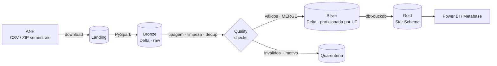
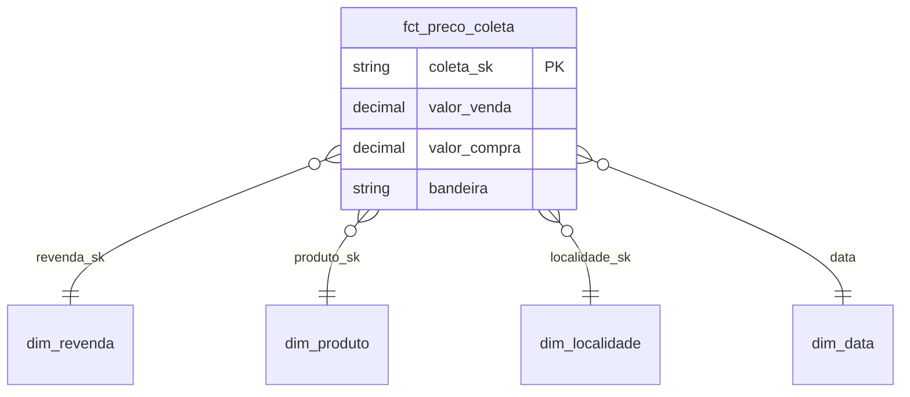

# ⛽ ANP Fuel Prices Lakehouse

[](https://github.com/nielknauan/anp-fuel-prices-lakehouse/actions/workflows/ci.yml)


Pipeline de dados **end-to-end em arquitetura medalhão** com a série histórica de preços de combustíveis da **ANP** (dados abertos do governo federal, milhões de coletas por semestre).

> Ingestão incremental → **Bronze** (Delta) → **Silver** (PySpark + regras de qualidade + MERGE) → **Gold** (dbt, Star Schema testado) → consumo em BI.

---

## 🏛️ Arquitetura



| Camada | Tecnologia | O que acontece |
|---|---|---|
| **Landing** | Python | Baixa semestres da ANP (trata `.csv` antigos e `.zip` recentes) |
| **Bronze** | PySpark + Delta | Dado bruto (tudo string), encoding `ISO-8859-1`, colunas em snake_case, metadados `_source_file` / `_ingested_at`. Escrita idempotente com `replaceWhere` por arquivo |
| **Silver** | PySpark + Delta | Tipagem (decimal BR `5,699` → `5.699`, datas `dd/MM/yyyy`), CNPJ/CEP normalizados, deduplicação por chave natural, **quality checks** e **MERGE** (upsert) incremental |
| **Gold** | dbt + DuckDB | Star Schema (`fct_preco_coleta` + 4 dimensões) e mart agregado `agg_preco_medio_mensal_uf`, com **18 testes de dados** |

## 🥇 Modelo dimensional (Gold)



## ✅ Qualidade e governança

- **Quarentena em vez de descarte:** registros inválidos vão para `precos_combustiveis_quarentena` com o array `_dq_falhas` (ex.: `preco_nulo`, `preco_fora_da_faixa`, `cnpj_invalido`), para auditoria.
- **Idempotência:** reprocessar o mesmo semestre não duplica dados (`replaceWhere` na Bronze + `MERGE` na Silver). Isso é validado no CI, que roda o pipeline duas vezes.
- **Testes em duas camadas:** `pytest` para a lógica PySpark e `dbt build` para unicidade, nulos, integridade referencial e regras de negócio na Gold.
- **LGPD:** parte das revendas são empresários individuais, então o CNPJ **não é exposto na Gold**. A chave `revenda_sk` é um hash do documento.

## 🚀 Como rodar

**Com Docker (recomendado):**

```bash
docker build -t anp-lakehouse .
docker run --rm anp-lakehouse                                   # testes + pipeline com a amostra
docker run --rm anp-lakehouse make run gold SEMESTERS="2025-01" # dados reais da ANP
```

**Local (Python 3.11+ e Java 17+):**

```bash
make install
make all                          # testes + bronze/silver (amostra) + gold
make run gold SEMESTERS="2024-02 2025-01 2025-02"
```

Resultado: as tabelas Delta ficam em `lakehouse/` e a Gold fica em `lakehouse/gold/anp.duckdb`.

```sql
-- Preço médio da gasolina por UF no último mês
select uf, preco_medio, qtd_revendas
from gold.agg_preco_medio_mensal_uf
where produto = 'GASOLINA'
  and ano_mes = (select max(ano_mes) from gold.agg_preco_medio_mensal_uf)
order by preco_medio desc;
```

## 📁 Estrutura

```
├── src/anp_lakehouse/
│   ├── ingest.py      # landing: download CSV/ZIP da ANP
│   ├── bronze.py      # raw -> Delta
│   ├── silver.py      # tipagem, dedup, MERGE
│   ├── quality.py     # regras de qualidade + quarentena
│   └── pipeline.py    # orquestração (CLI)
├── dbt/models/
│   ├── staging/       # contrato com a Silver
│   └── marts/         # Star Schema + agregados + testes
├── tests/             # pytest (PySpark)
├── data/sample/       # amostra real da ANP p/ CI e execução offline
├── Dockerfile · Makefile · .github/workflows/ci.yml
```

## 🔄 Rodando no Databricks

O código das camadas Bronze e Silver é PySpark e Delta puro. Para portar, basta trocar os caminhos por tabelas do Unity Catalog (`catalog.schema.tabela`) e rodar `pipeline.py` como Job. A Gold pode usar o `dbt-databricks` no lugar do `dbt-duckdb`, mantendo os mesmos modelos.

---

**Fonte dos dados:** [ANP – Série Histórica de Preços de Combustíveis](https://www.gov.br/anp/pt-br/centrais-de-conteudo/dados-abertos/serie-historica-de-precos-de-combustiveis) (dados abertos).
Autor: [Nielk Nauan](https://www.linkedin.com/in/nielknauan/)
